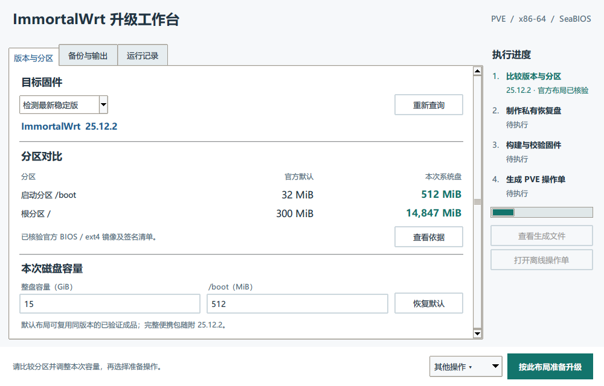

# RouterUpgrade · ImmortalWrt 升级工作台

RouterUpgrade 是一个 Windows 桌面工具，用来为 Proxmox VE 上的 ImmortalWrt 主路由准备升级。它可以先读取官方镜像的真实分区表，让你比较和调整容量，再分别制作可启动的系统盘和装有个人配置的临时恢复盘。原路由器可以工作到你决定切换的那一刻。

**当前版本 0.2.0** 适用于 ImmortalWrt 25.12.x、x86/64、SeaBIOS 和 VirtIO SCSI。内置恢复方案面向已有 **AdGuard Home 与 OpenClash** 的路由器。只查询公开固件的版本和分区，无需提供备份。

## 我该用哪个包？

| 拿到的文件 | 适合的用途 | 需要 Docker 吗？ |
|---|---|---|
| GitHub 源码或源码 ZIP | 运行图形界面、查询版本、开发及自行构建。解压后与 `gui.py` 同级的是启动入口 `start.cmd` | 查版本及分区、制作私有恢复盘均可在 Windows 上完成。首次制作系统盘通常需要本机 Docker |
| `RouterUpgrade-0.2.0-Windows-25.12.2.zip`（若发行页提供） | 工具和已验证的 25.12.2 默认系统盘都在里面，适合直接使用 | 15 GiB / 512 MiB 的默认布局可直接复用。其他布局首次构建需要 Docker |
| `RouterUpgrade-firmware-25.12.2.zip`（若单独提供） | 已验证的公开固件。可与源码一起使用，放在 `start.cmd` 旁或从向导导入 | 复用此默认成品无需 Docker |

`0.2.0` 是桌面程序版本，`25.12.2` 是配套固件版本。GitHub 的 **Code → Download ZIP** 下载的是仓库源码。程序也可以复用本机先前通过校验的成品，前提是发行版本、整盘容量和启动分区容量都匹配。

## 从查询到换盘

1. **启动向导。** Windows 需安装 Python 3.10 或以上并带 Tcl/Tk。完整解压后双击 `start.cmd`，或在项目目录运行 `python -B gui.py`。联机校验官方签名还需要 Python 的 `cryptography` 或支持 Ed25519 的 OpenSSL 3。自建固件使用 Docker Desktop 的本机 Linux 引擎。
2. **先比较官方布局。** 点「查询版本与分区」。程序识别正式版本，验证官方签名清单及整份 x86/64 BIOS ext4 镜像的 SHA-256，再读取镜像的 MBR。例如 25.12.2 的官方镜像启动分区为 **32 MiB**、根分区为 **300 MiB**。如果核验失败，界面会显示原因，等你决定如何继续。断网时可以选「离线指定版本」。[官方发布目录](https://downloads.immortalwrt.org/releases/)
3. **选择容量。** 默认整盘 **15 GiB**，其中 `/boot` 占 **512 MiB**，根分区占 **14,847 MiB**。可选整盘 2–128 GiB、`/boot` 32–4,096 MiB，均为整数，根分区至少 512 MiB。根分区大小等于整盘 MiB 减去启动分区，再减去 BIOS 布局的 1 MiB 间隔。
4. **准备配置。** 选一份在旧系统工作正常时导出的 LuCI/sysupgrade 配置备份。向导会核对网络、防火墙、DHCP、SSH、ADH 主配置、活动 OpenClash YAML 和可执行的代理核心。已有的过滤列表及符合条件的 Argon 背景可随备份恢复；缺少的过滤列表可从本地目录补充。PVE 整机备份单独保存，用于整机回退。
5. **生成文件。** 点「按此布局准备升级」，检查向导列出的恢复范围，并分别记录两块盘的 SHA-256。在电脑上打开生成的离线 PVE 操作单。

| 输出 | 去向 |
|---|---|
| `router.qcow2` | 新系统盘。在自己的 PVE 通过 Import 导入，作为**可写启动盘** |
| `restore-….raw` | 私有临时恢复盘。也通过 PVE Import 导入，设为**只读**。每份都对应此次备份、目标版本和布局 |
| `restore-….tar.gz` | 临时盘内精选配置的独立副本，保存在本机私有目录 |
| `PVE-cutover-….html` | 在电脑上离线阅读。包含卷 ID 核对、网卡隔离、恢复、验收和回退的操作步骤 |

**看到 `RESTORE_OK` 后，请先关机。** 等 PVE 显示 Stopped，按卷 ID 分离只读恢复盘，仅用新系统盘冷启动，再接回 LAN。此时新系统会加载恢复后的网络配置。先从独立客户端验证管理页面、DHCP 和 DNS，再接回 WAN 验证订阅、IPv6 或 VPN。旧卷保留为 Unused，直到现场业务通过并完成包含新系统盘的新整机备份。

## 个人数据与公开文件

公开构建使用发行版的软件包和公开的上游程序。选择备份、筛选配置、合并账户及制作恢复盘都在本机完成。请把公开构建目录与私有输出目录分开，私有目录选在自己控制且未开启云同步的位置。

LuCI 备份、PVE 整机备份、`restore-….raw` 和 `restore-….tar.gz` 都可能包含密码哈希、SSH/VPN 密钥、代理订阅与客户端信息。恢复范围省略 ADH 查询历史；已备份的 OpenClash 历史数据库可能随精选配置保留。提交 GitHub Issue 时，可提供目标版本、所选容量、出错阶段及脱敏后的错误行。请把私人备份、真实活动 YAML 和完整诊断日志留在本机。

## 命令行与验证

在项目目录中运行。以下文件夹和备份名是示例，运行前请换成本机路径。

~~~powershell
python upgrade.py latest --partitions
python upgrade.py build --version 25.12.2 --disk-gib 20 --boot-mib 768 --public-dir .\public
python upgrade.py verify --version 25.12.2 --disk-gib 20 --boot-mib 768 --public-dir .\public
python upgrade.py prepare --version 25.12.2 --disk-gib 20 --boot-mib 768 --backup .\backup.tar.gz --private-dir .\private
python upgrade.py --help
~~~

图形界面会先展示分区对比。CLI 的 `run` 按给定参数准备系统盘、恢复盘及操作单。使用默认布局时恢复盘标记为 V2；自定义布局使用携带容量标识的 V3。改动容量后，应使用该布局配套的两块盘。

0.2.0 曾用 **20 GiB / 768 MiB** 自定义成品完成 SeaBIOS 冷启动、合成配置恢复和移除恢复盘后的再次启动。同容量但 `/boot` 不匹配的恢复盘在写入前被拒绝。仓库的 CI 使用合成输入运行单元测试；磁盘冷启动和真实 PVE 网络切换是单独的验收步骤。[默认布局的历史验证记录](docs/verification-0.1.1.md)

~~~powershell
python -B -m unittest discover -s tests -p "test_*.py"
~~~

## 维护与发行

- 界面入口为 [gui.py](gui.py)，CLI 和共享入口为 [upgrade.py](upgrade.py)。公开软件清单在 [router-packages.txt](engine/templates/router-packages.txt)，恢复筛选规则在 [private_rules.py](engine/private_rules.py)。
- 新系列或发布密钥变动时，需要适配签名、包管理器和构建配方，再重新验证启动与恢复。默认公开成品可以用 `python tools/bundle_firmware.py 25.12.2 <已验证的公开目录> <发布输出目录> --record` 打包并登记完整 ZIP 的摘要。
- 维护者分发预构建镜像或含固件的 Windows 包前，应按实际软件清单准备第三方许可证、通知及适用的对应源码。仓库源码与含固件的 Release 附件分别管理。[ImmortalWrt](https://github.com/immortalwrt/immortalwrt) · [AdGuard Home](https://github.com/AdguardTeam/AdGuardHome) · [OpenClash](https://github.com/vernesong/OpenClash)
